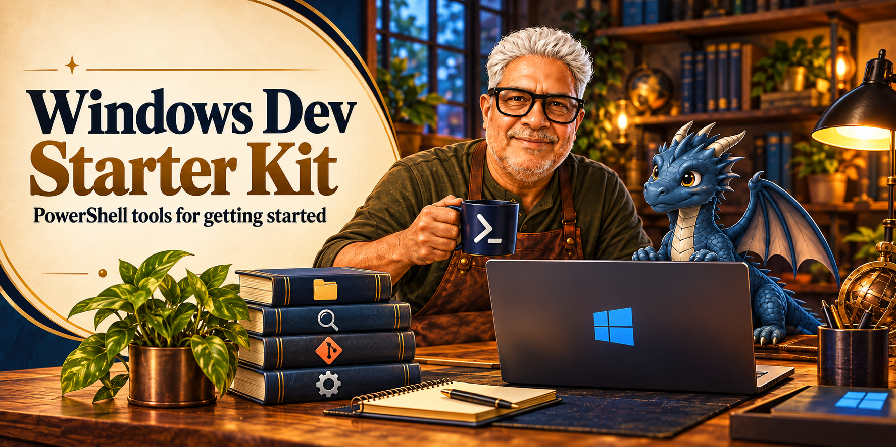

# Windows Dev Starter Kit: PowerShell Edition

A beginner-friendly set of PowerShell commands for working with software projects on Windows. The commands make common project chores easier to remember: inspect a project, find files or text, package source, apply an update, build, test, and run.

This is a personal starter toolkit, not a replacement for the tools or workflows experienced developers already use.

## Quick start

1. Place this folder under your development folder, for example `D:\dev\windows-dev-starter-kit-powershell`.
2. Open PowerShell in that folder and load the commands into the current session:

   ```powershell
   . .\dev.ps1
   ```

3. Enter one of your project folders under `D:\dev` or `E:\dev` and use `dev` to see the command guide:

   ```powershell
   cd D:\dev\MyProject
   dev
   ```

To load the commands automatically in future PowerShell sessions, add a dot-source line for this script to your PowerShell profile. The profile path is shown by `$PROFILE`.

## Start with these commands

| 3-letter command | What it does | Full command name |
|---|---|---|
| `dev` | Show the command list | `Dev-Help` |
| `gpi` | Show project name and technology | `Get-ProjectInfo` |
| `cdd` | Choose a project folder | `Select-Project` |
| `sht` | Browse project folders and files | `Show-Tree` |
| `fff '*seaport*'` | Find files by name or wildcard | `Find-File` |
| `fft 'sea terminal'` | Search inside readable text files | `Find-Text` |
| `pjs` | Show Git branch and changes | `Get-ProjectStatus` |
| `bld` | Build the project | `Build-Project` |
| `tst` | Run project tests | `Test-Project` |
| `run` | Run the project | `Run-Project` |
| `go` | Build, test, then run | `Build-Test-Run` |
| `utf` | Set console and pipe encoding to UTF-8 | `Set-ConsoleUtf8` |
| `tif` | Show PowerShell, encoding, and screen details | `Get-TerminalInfo` |
| `ocf` | Open a folder in File Explorer | `Open-CurrentFolder` |
| `pro` | List running programs | `Show-Processes` |
| `fpr chrome` | Find a running program by name | `Find-Process` |
| `spp 1234` | Stop one process by ID; asks first | `Stop-ProjectProcess` |

## Build and run cycle

These commands are shortcuts for a common project workflow:

```powershell
bld   # build

tst   # test

run   # run

go    # build, test, then run if the earlier steps pass
```

Other commands:

- `src` creates a source ZIP under the `source` folder on the current drive's `\dev` directory.
- `upd` applies the newest matching update ZIP from that `source` folder. Review the listed files; the command proceeds automatically after a short countdown unless you press Enter to proceed immediately or Ctrl+C to cancel.
- `rpj` lists project folders by recent activity.
- `lsc` lists Syncthing conflict copies.
- `csc` interactively removes conflict copies. Use `-WhatIf` to preview.

The process-stop command takes a process ID, shows which program it will stop, and asks for confirmation. Use `fpr` first to find the right ID. `-WhatIf` previews the action.

## File filtering

File browsing, file search, text search, and source packaging share the same default filter behavior:

- `.gitignore` rules accumulate from the project folder upward through the drive root.
- When no applicable `.gitignore` exists, built-in defaults skip common generated folders, archives, compiled files, and large audio/video files.
- `-Full` bypasses filtering. For example, `fff '*.zip' -Full` searches for ZIP files too.
- Text search skips binary files even with `-Full`.

The included `.gitignore` is intended to be copied to a drive root, for example `D:\.gitignore` or `E:\.gitignore`. It filters common generated folders such as `node_modules`, Android/Gradle and compiler output, plus archives and bulky media files. Review the patterns before using it if you want different results across projects.

## Requirements and notes

- Windows PowerShell with Windows Forms support for the `cdd` project picker.
- Git is optional; `pjs` needs Git, and source packaging uses the built-in file filter.
- The build, test, and run commands detect basic .NET and Node project setups. Other project types may need their own commands.
- `-Full` can include large generated folders and files, so searches may take longer.
